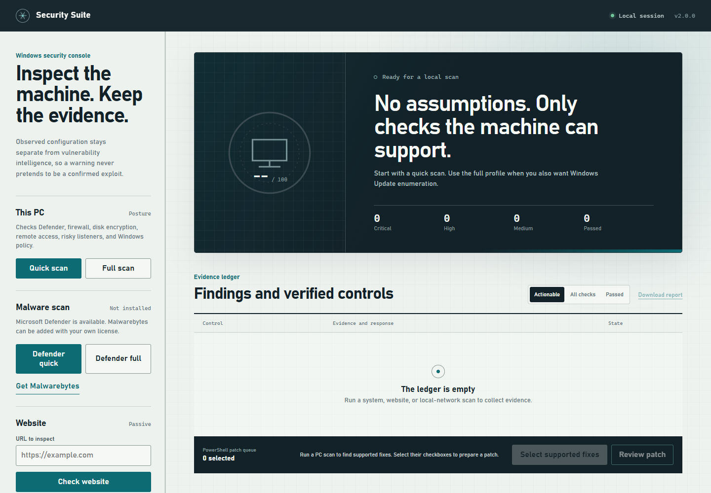
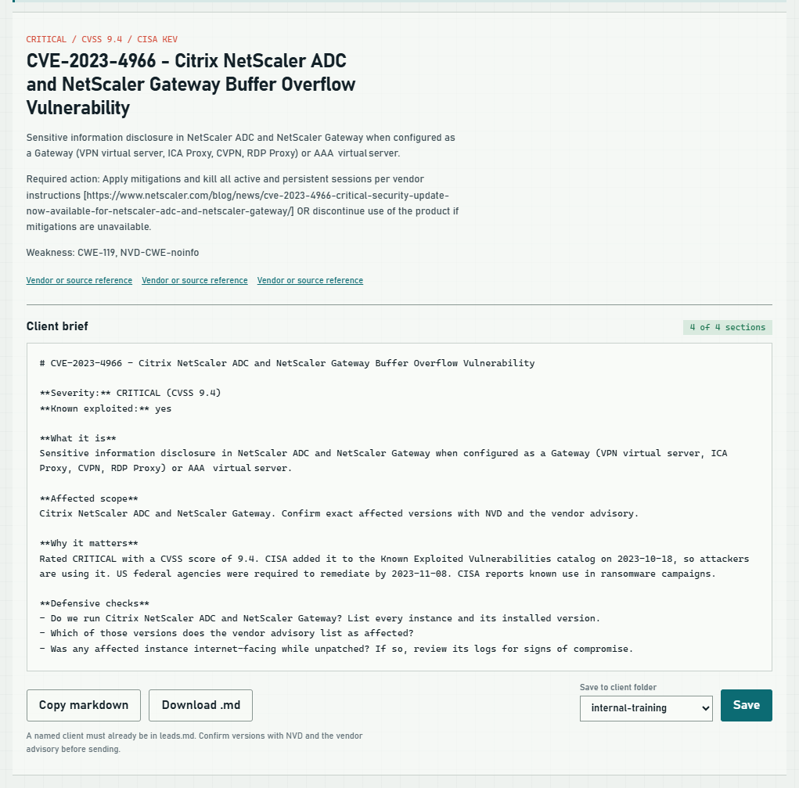

# Security Suite



**New here? Read the [Security Suite Guide](docs/MANUAL.md)** for step-by-step instructions with screenshots.

Security Suite is a local Windows security dashboard and CLI. It separates three kinds of evidence:


- Local posture: Defender or another registered antivirus, firewall, BitLocker, Secure Boot, SMBv1, UAC, RDP/NLA, LLMNR, AutoRun, services, pending restart state, and listening ports.
- Passive website checks: TLS validation, security headers, cookie flags, CORS, mixed content, and response status.
- Private-network exposure: TCP reachability for a host or a CIDR of at most 256 addresses.

It does not exploit targets, store payloads, or assign CVEs from port numbers. CVE detail comes from the NIST National Vulnerability Database, while CISA's Known Exploited Vulnerabilities catalog is used to prioritize flaws confirmed as exploited in the wild.

## Start the dashboard

Requires Windows, Python 3.10 or later, and Windows PowerShell 5.1 or later. The application uses only the Python standard library.

```powershell
git clone https://github.com/gocar112/security-suite.git
cd security-suite
python .\security_suite.py launch
```

Double-click **Open-Security-Suite.cmd** to start or reopen the dashboard. It stays running in the background after the launcher closes. The preferred address is `http://127.0.0.1:8766/`; when that port is unavailable, the launcher uses a nearby free port and opens the actual address. Run the launcher again to reopen the same verified instance. Its address and process ID are in `runtime/dashboard.json`; startup logs are in `runtime/dashboard.log`.

The dashboard rejects non-loopback bindings, cross-origin writes, invalid host headers, and POST requests without the session CSRF token. `python security_suite.py serve` remains available for foreground operation; closing that terminal stops that foreground instance.

You can also launch it from PowerShell:

```powershell
.\Start-Security-Suite.ps1
```

If PowerShell blocks scripts under the current execution policy, use `Open-Security-Suite.cmd` or `python security_suite.py launch`. Neither requires a permanent execution-policy change.

## Scan from the CLI

```powershell
# Fast local posture scan
python .\security_suite.py system-scan --profile quick --output json

# Adds pending Windows Update enumeration
python .\security_suite.py system-scan --profile full --output json

# Passive website review; no fuzzing or form submission
python .\security_suite.py website-scan --url https://example.com

# Common TCP ports on a private host
python .\security_suite.py vuln-scan --target 192.168.1.10 --quick

# Refresh CISA KEV and fetch current NVD detail for one CVE
python .\security_suite.py intel-sync
python .\security_suite.py info --cve CVE-2023-23397 --live

# Write a client-ready CVE brief to a markdown file
python .\security_suite.py info --cve CVE-2023-4966 --live --outfile .\CVE-2023-4966.md
```

Only scan hosts you own or are authorized to assess. Public network targets are blocked unless the CLI receives the explicit `--allow-public` flag.

## CVE client briefs

Any CVE in NVD or the CISA KEV catalog produces a brief with five sections: what it is, affected scope, why it matters, defensive checks, and remediation, plus references. Curated records cover a few well-known CVEs; for every other CVE the sections are derived from KEV and NVD fields. References that NVD tags as exploits, or that point at known exploit archives, are dropped.

In the dashboard, look up a CVE and choose **Build client brief** to copy the markdown, download it, or save it to a client folder. Client folders are the lowercase subfolders of `..\clients` beside this checkout; the dashboard never overwrites an existing brief without confirmation.



## Malware scanners

Microsoft Defender quick and full scans can be started from the dashboard. A posture scan does not read every file, so use one of those malware scan actions when file inspection is required.

The dashboard also detects common Malwarebytes for Windows and Malwarebytes Toolset install paths. It launches an existing installation and uses Toolset's documented `/scan:malware` switch when Toolset is present. Security Suite does not redistribute Malwarebytes Pro, product keys, subscriptions, or installers. If Malwarebytes is absent, the UI links to the official Malwarebytes site.

## PowerShell patch bundles

Run **Quick scan** under This PC. Patchable findings have a checkbox. Choose **Select supported fixes**, then **Review patch** to see the detected evidence and exact script. **Download PowerShell patch** saves that reviewed script. Reloading the page restores the latest completed scan while the server is running. The generated `.ps1` file:

- contains commands selected from a fixed allowlist;
- rejects arbitrary input;
- previews the proposed changes by default; `-Apply` is required for changes;
- requires an elevated PowerShell session to apply;
- writes a transcript and a backup of selected LLMNR/AutoRun registry values to `SecuritySuite-Backups` beside the script;
- asserts each expected setting after applying and stops with an error if verification fails;
- reports when a restart is required.

Review the script before running it. High-impact changes such as enabling BitLocker or Secure Boot are intentionally manual because recovery-key and firmware decisions should not be automated blindly.

From PowerShell in the patch folder, preview with:

```powershell
powershell.exe -NoProfile -ExecutionPolicy RemoteSigned -File .\security-suite-patches.ps1
```

After review, open PowerShell as administrator and add `-Apply`. `RemoteSigned` is scoped to that process; it does not change the machine's execution policy. If a reviewed download is marked blocked, use the file's Properties > Unblock first. Organization policy can require a signed script.

Rollback for LLMNR and AutoRun only is available using the backup path printed during apply:

```powershell
powershell.exe -NoProfile -ExecutionPolicy RemoteSigned -File .\security-suite-patches.ps1 -Apply -RollbackFrom '.\SecuritySuite-Backups\RUN-ID\registry.json'
```

Rollback validates the computer and allowed policy IDs, saves the current values before restoring, and checks the result. Other patch types need manual recovery. After applying or restoring, run a fresh PC scan. Downloading never applies a patch or restarts Windows.

## Test

```powershell
python -m unittest discover -s tests -v
python .\security_suite.py self-check
node --check .\web\app.js
```

## Current limits

- IDS packet capture remains a clearly labeled placeholder and is not part of the posture score.
- Application CVE matching requires reliable product and version inventory. The suite provides NVD/KEV research but does not claim that a CVE affects the PC merely because a related port is open.
- Some Windows checks need administrator-readable system providers. A blocked check is shown as `UNCHECKED`, not guessed.
- Full Windows Update enumeration can take several minutes depending on update-service health.

## License

MIT. See [LICENSE](LICENSE).
