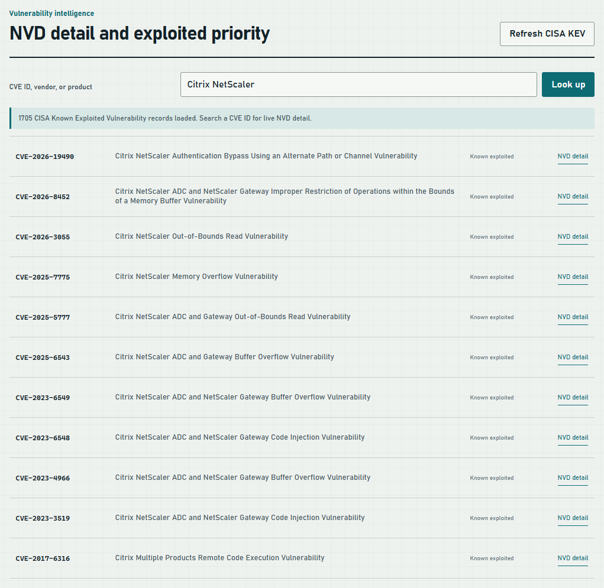

# Security Suite Guide

How to install, run, and get useful results from Security Suite.

## Contents

1. What it does
2. Install and start
3. A tour of the dashboard
4. Scan this PC
5. Check a website
6. Check your local network
7. Look up a vulnerability
8. Write a client CVE brief
9. Fix findings with a patch bundle
10. Use the command line
11. Troubleshooting
12. Safety and limits

## 1. What it does

Security Suite is a local dashboard and command-line tool for Windows. It answers three questions, and keeps their evidence separate:

- **Is this PC configured safely?** Defender, firewall, BitLocker, Secure Boot, SMBv1, UAC, RDP, LLMNR, AutoRun, services, pending restarts, and listening ports.
- **Is this website configured safely?** TLS, security headers, cookie flags, CORS, mixed content, and response status. Passive checks only.
- **What is exposed on my network?** TCP reachability for one private host or a range of up to 256 addresses.

It also looks up vulnerabilities in the NIST National Vulnerability Database (NVD) and the CISA Known Exploited Vulnerabilities (KEV) catalog, and turns them into client-ready briefs.

It never exploits anything. A warning is a configuration observation, not proof that a CVE affects you.

## 2. Install and start

You need Windows, Python 3.10 or later, and Windows PowerShell 5.1 or later. There are no packages to install; it uses only the Python standard library.

```powershell
git clone https://github.com/gocar112/security-suite.git
cd security-suite
python .\security_suite.py launch
```

Your browser opens the dashboard at `http://127.0.0.1:8766/`. If that port is busy, it picks the next free port and opens that instead.

Other ways to start it:

- Double-click **Open-Security-Suite.cmd**. Run it again to reopen the same dashboard.
- Run `.\Start-Security-Suite.ps1` from PowerShell.
- Run `python .\security_suite.py serve` to keep it in the foreground. Closing that terminal stops it.

The dashboard keeps running in the background after the launcher closes. Its address and process ID are in `runtime\dashboard.json`.

Check the install without scanning anything:

```powershell
python .\security_suite.py self-check
```

## 3. A tour of the dashboard


- **Left panel:** the actions. This PC, Malware scan, Website, Local network, and Threat intelligence.
- **Score panel:** your posture score out of 100 and counts of Critical, High, Medium, and Passed checks after a scan.
- **Evidence ledger:** every finding with its evidence and state. Filter by **Actionable**, **All checks**, or **Passed**. **Download report** saves the full result as JSON.
- **Patch queue:** the bar under the ledger. It collects fixes you select.
- **Vulnerability intelligence:** search CVEs further down the page.

The dashboard only listens on `127.0.0.1`. It rejects other hosts, cross-origin requests, and requests without its session token.

## 4. Scan this PC

1. Under **This PC**, choose **Quick scan**. It takes about 20 seconds.
2. Choose **Full scan** instead when you also want pending Windows Updates. That can take several minutes.
3. Read the score panel, then the **Actionable** findings in the ledger.

Each finding shows what was checked, what was observed, and what to do. A check Windows would not let the suite read shows as `UNCHECKED`. It is not counted as a pass or a failure.

A posture scan does not read every file. For malware, use **Defender quick** or **Defender full** under Malware scan. If Malwarebytes is installed, the dashboard can launch it too.

## 5. Check a website

1. Under **Website**, enter a full URL such as `https://example.com`.
2. Choose **Check website**.

The suite makes normal requests and reads the response. It does not fuzz, submit forms, or crawl. Only check sites you own or are allowed to assess.

## 6. Check your local network

1. Under **Local network**, enter a private host or range you own, for example `192.168.1.10` or `192.168.1.0/24`.
2. Leave **Use common ports** checked for a fast check, or uncheck it and enter ports such as `1-1024` or `80,443`.
3. Choose **Scan exposure**.

Public addresses are blocked in the dashboard. An open port is reported as exposure, not as a vulnerability.

## 7. Look up a vulnerability



1. In **Vulnerability intelligence**, type a vendor, product, or CVE ID.
2. A vendor or product search lists matching records from the local KEV catalog.
3. An exact CVE ID, or **NVD detail** on any row, fetches the live NVD record: severity, CVSS score, description, required action, weaknesses, and references.

Choose **Refresh CISA KEV** about once a month so the catalog includes newly exploited vulnerabilities. If NVD cannot be reached, the suite shows the offline record and says so.

## 8. Write a client CVE brief


1. Look up a CVE, as in section 7.
2. Choose **Build client brief**.
3. Check the badge. **4 of 4 sections** means the brief has What it is, Why it matters, Defensive checks, and Remediation. A red badge names any section that is missing.
4. Choose **Copy markdown**, **Download .md**, or pick a client folder and choose **Save**.

**Where briefs are saved.** Client folders are the lowercase subfolders of a `clients` folder next to your checkout, for example `..\clients\acme-corp`. Create the folder first. The dashboard never replaces an existing brief without asking.

**Before you send a brief.** Confirm the affected versions against NVD and the vendor advisory. The brief tells the reader what to check and what to do. It never includes exploit steps, and references that point at exploit code are removed.

## 9. Fix findings with a patch bundle

Some PC findings can be fixed with a reviewed PowerShell script.

1. Run **Quick scan**. Fixable findings show a checkbox.
2. Choose **Select supported fixes**, or tick individual findings.
3. Choose **Review patch** to see the evidence and the exact script.
4. Choose **Download PowerShell patch**.

Preview the changes. Nothing is changed without `-Apply`:

```powershell
powershell.exe -NoProfile -ExecutionPolicy RemoteSigned -File .\security-suite-patches.ps1
```

To apply, open PowerShell **as administrator** and add `-Apply`. The script backs up the LLMNR and AutoRun values it changes, checks each setting afterwards, and stops if a check fails. To undo those two changes:

```powershell
powershell.exe -NoProfile -ExecutionPolicy RemoteSigned -File .\security-suite-patches.ps1 -Apply -RollbackFrom '.\SecuritySuite-Backups\RUN-ID\registry.json'
```

Run a new scan afterwards to confirm. BitLocker and Secure Boot are never automated, because recovery keys and firmware settings need a person's decision.

## 10. Use the command line

Every dashboard action has a command. Add `--output json` or `--outfile <path>` to save results.

| Task | Command |
|---|---|
| Quick PC scan | `python .\security_suite.py system-scan --profile quick --output json` |
| Full PC scan | `python .\security_suite.py system-scan --profile full --output json` |
| Website check | `python .\security_suite.py website-scan --url https://example.com` |
| Network exposure | `python .\security_suite.py vuln-scan --target 192.168.1.10 --quick` |
| PC + network + website | `python .\security_suite.py audit --website https://example.com` |
| Defender scan | `python .\security_suite.py malware-scan --provider defender --scan-type quick` |
| Refresh KEV catalog | `python .\security_suite.py intel-sync` |
| CVE lookup | `python .\security_suite.py info --cve CVE-2023-4966 --live` |
| CVE brief to a file | `python .\security_suite.py info --cve CVE-2023-4966 --live --outfile .\CVE-2023-4966.md` |
| Port meaning | `python .\security_suite.py info --port 445` |
| List known CVEs | `python .\security_suite.py info --list` |

`vuln-scan` refuses public addresses unless you add `--allow-public`, which you should only use with written authorization.

## 11. Troubleshooting

| Problem | Fix |
|---|---|
| Dashboard does not open | Run `python .\security_suite.py launch` again. Check `runtime\dashboard.log`. |
| Port 8766 busy | Nothing to do; the launcher picks the next free port and opens it. |
| `UNCHECKED` findings | Run the dashboard from an elevated terminal for checks that need administrator access. |
| Live NVD lookup failed | You are offline or NVD is rate-limiting. The brief uses offline data and says so. Set the `NVD_API_KEY` environment variable for higher limits. |
| KEV catalog is old | Choose **Refresh CISA KEV** or run `intel-sync`. |
| No client folders in the Save list | Create a lowercase folder such as `clients\acme-corp` next to the checkout, then reload the page. |
| PowerShell blocks the launcher | Use `Open-Security-Suite.cmd` or `python .\security_suite.py launch`; neither changes execution policy. |
| Brief text shows odd characters in the console | Update to the latest version; console output now replaces characters Windows cannot display. |

## 12. Safety and limits

- Scan only systems you own or are authorized to assess.
- The suite reports configuration and exposure. It does not claim a CVE affects a machine because a port is open; that needs a reliable product and version inventory.
- IDS packet capture is a labeled placeholder and does not affect the score.
- Patch scripts come from a fixed allowlist, preview by default, and need administrator rights to apply. Review every script before running it.

Run the tests after changing the code:

```powershell
python -m unittest discover -s tests -v
node --check .\web\app.js
```
